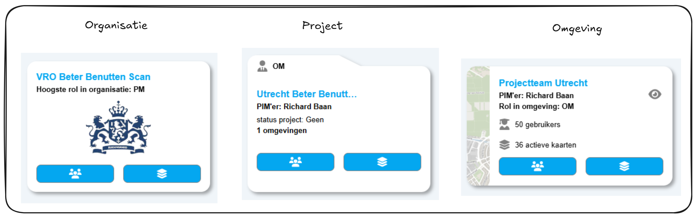
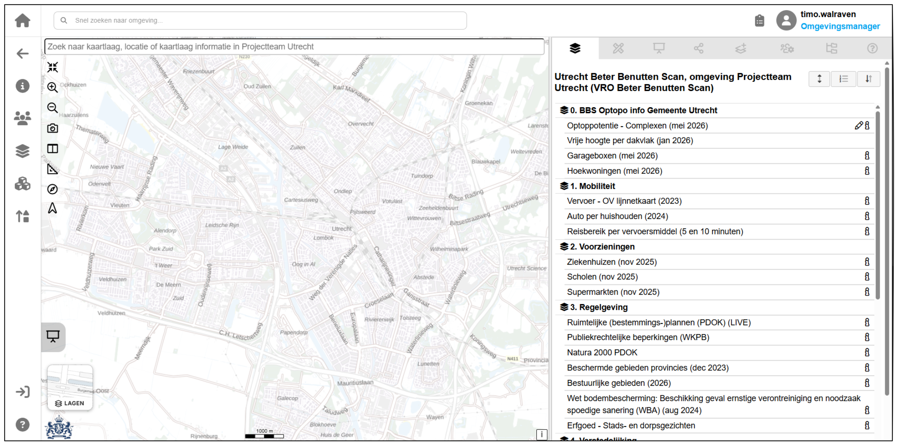

De Beter Benutten Scan wordt aangeboden via het PIM platform, een ontwikkeling uit het samenwerkingsverband Circol. Als je ooit een geo-viewer hebt gebruikt, dan zal het PIM platform vergelijkbaar aanvoelen. Dit document bevat alle informatie die je nodig hebt om te begrijpen hoe het PIM platform werkt en hoe je de Beter Benutten Scan kunt gebruiken. Ga naar [de gebruikshandleiding](../gebruikshandleiding/index.md) om te leren hoe je de scan kunt gebruiken en naar [de technische documentatie](../technische-documentatie/index.md) om te leren hoe de scan onder de motorkap werkt.

## Wat is het PIM platform?

Het PIM platform is een ontwikkeling van [PIM.info](https://pim.info), een onderdeel van de coöperatie Circol. Het platform is ontwikkeld om het gebruik van geo-data en geo-informatie te vereenvoudigen en te verbeteren. Het biedt een centrale plek waar gebruikers toegang hebben tot verschillende geo-tools en -applicaties, waaronder de Beter Benutten Scan.

## Hoe kom ik in het PIM platform?

Na het aanmelden bij de Beter Benutten Scan ontvangt de opgegeven data beheerder een uitnodiging om een account aan te maken in het PIM platform. De data beheerder kan vervolgens andere gebruikers uitnodigen om de scan te gebruiken. Deze uitnodiging kan in je spamfolder terechtkomen. Controleer dus ook je spamfolder als je de uitnodiging niet in je inbox kunt vinden. 

Weet je niet zeker wie de data beheerder is? Neem dan contact op via [ondersteuning](ondersteuning.md).

Na het aanmaken van een account kun je [inloggen op het PIM platform](https://pimplatform.nl/).

Vervolgens moeten we navigeren naar de te gebruiken omgeving. PIM werkt met drie lagen: organisaties, projecten en omgevingen. Voor ons is "BZK beter benutten scan" de organisatie, de gemeentenaam het project en Projectteam <Gemeentenaam> de omgeving. Bijvoorbeeld Gemeente Utrecht:

Na het openen van je omgeving krijg je het volgende beeld:

## Hoe gebruik ik het PIM platform?

Bekijk onderstaande video's om te leren hoe het PIM platform werkt en je de Beter Benutten Scan functionaliteiten gebruikt.

  

    

      

        <iframe
          src="https://www.youtube-nocookie.com/embed/FeTULRoI8V8?si=molt4TTL5MaOBAEp"
          title="Basisfunctionaliteiten van het PIM-platform"
          loading="lazy"
          allow="accelerometer; autoplay; clipboard-write; encrypted-media; gyroscope; picture-in-picture; web-share"
          allowfullscreen>
        </iframe>
      

    

    

      <h3>Basisfunctionaliteiten</h3>
      
Sara laat zien hoe je navigeert binnen het PIM-platform en de belangrijkste basisfunctionaliteiten gebruikt.

    

  

  

    

      

        <iframe
          src="https://www.youtube-nocookie.com/embed/_3u7OSGxaGw?si=3DVNvd4N7F6Gv2k4"
          title="Gebruik van de Beter Benutten Scan in het PIM-platform"
          loading="lazy"
          allow="accelerometer; autoplay; clipboard-write; encrypted-media; gyroscope; picture-in-picture; web-share"
          allowfullscreen>
        </iframe>
      

    

    

      <h3>Potentie doorrekenen</h3>
      
Erald legt uit hoe je de functionaliteiten van de Beter Benutten Scan gebruikt.

    

  

Raadpleeg voor meer informatie de recentste handleiding, te vinden via de hulpknop links onder in het platform:

  

