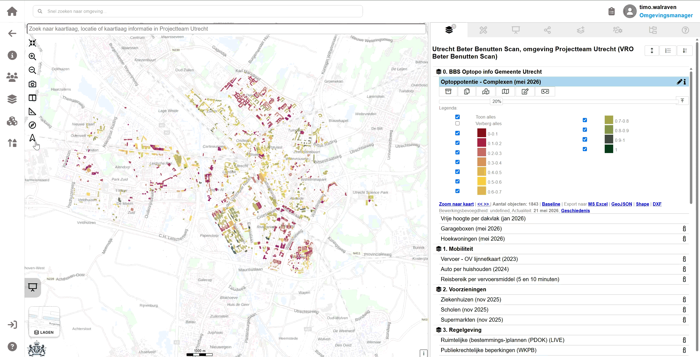

## Filteren
Interactieve lagen kunnen worden gefilterd op basis van eigenschappen van de laag. 
1. open het modulepaneel
2. selecteer de module van de laag die je wilt filteren
3. open de attributentabel
4. Filter de attributentabel op basis van de eigenschappen van de laag. 

## Wegen  
Interactieve lagen kunnen per criteria worden gewogen.
## Scenario's
Combinaties van filters en wegingen kunnen worden opgeslagen als scenario's. Deze scenario's kunnen later weer worden geladen.
**opslaan**  
Via het modulepaneel kunnen scenario's worden opgeslagen door:  
**laden**  
Een opgeslagen scenario kan worden geladen via het modulepaneel.
## Data exporteren  
Interactieve kaartlagen kunnen worden geëxporteerd naar CSV of GeoJSON. De geëxporteerde data bevat de objecten die zichtbaar zijn op de kaart en de eigenschappen van deze objecten.

